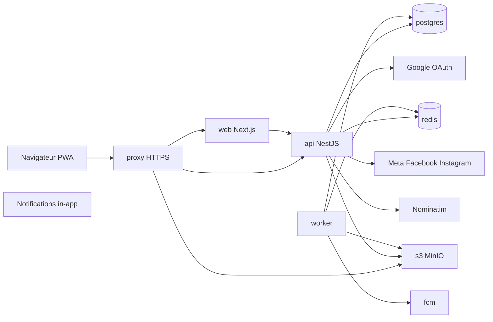
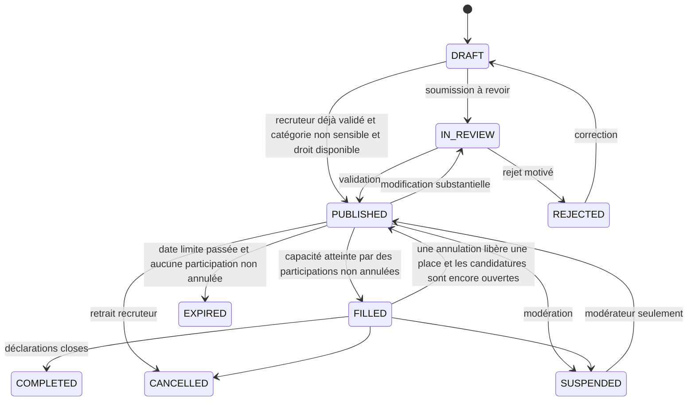

# Plan d’implémentation — BoulotFlash

| | |
| --- | --- |
| Document | Feuille de route de développement et de recette |
| Référence fonctionnelle | [CDC.md](CDC.md), version 1.2 du 21 octobre 2026 |
| Statut du CDC | Périmètre consolidé à valider avant développement |
| Code existant | Aucun. Le dépôt ne contient que `docs/CDC.md` et ce plan. |
| Ce document | Ne lance pas le développement. Aucune dépendance n’est installée. |

Les étapes détaillées, le schéma complété, les contrats API et la recette sont dans `docs/implementation/`. Ce fichier reste la porte d’entrée. Une hypothèse du CDC (section 23) n’est pas une décision validée : elle est reprise comme hypothèse de travail, marquée comme telle.

---

## 1. Synthèse du MVP et limites du périmètre

BoulotFlash met en relation, à Kinshasa, des personnes de 18 ans et plus et des recruteurs pour des missions de quelques heures à quelques jours. Le candidat ne paie jamais. Le salaire va directement d’une partie à l’autre. Les coordonnées et l’adresse exacte n’apparaissent qu’après acceptation d’une place.

Le MVP est une PWA unique, avec un espace administrateur non indexé, servie par une API REST `/api/v1`. Tout ce que BoulotFlash exécute tourne dans un Docker Compose : `web`, `api`, `worker`, `postgres`, `redis`, `s3` (`quay.io/minio/minio`), `proxy`.

### Dans le MVP

- Compte par Google, Facebook ou Instagram ; e-mail, téléphone et photo repris du provider ; création auto si le compte n’existe pas ; téléphone issu du provider obligatoire avant candidature ou publication. Guide consoles : [implementation/AUTH_OAUTH_PROVIDERS.md](implementation/AUTH_OAUTH_PROVIDERS.md).
- Un compte, modes candidat et recruteur distincts.
- Profils courts, 26 catégories, 24 communes de Kinshasa **inactives** tant qu’une activation explicite n’a pas eu lieu.
- Offre structurée, modération du premier recruteur et des catégories sensibles, lien public stable, partage sans message automatique.
- Carte Leaflet, tuiles OpenStreetMap ou MapTiler, géocodage Nominatim, distance Haversine côté client.
- Candidature, présélection, proposition qui réserve une place, acceptation, expiration, concurrence bornée par la capacité.
- Déclarations de réalisation, d’absence, d’annulation et de salaire. Retours privés.
- Notifications selon la matrice de la section 8 du CDC. L’alerte « offre correspondante » est **in-app seulement**, une fois, au premier passage en publication.
- Abonnement recruteur créé actif et gratuit. Interrupteur `services_payants` à faux. Paiement manuel seulement après activation.
- Signalements, administration, indicateurs, export CSV, sauvegarde et restauration.

### Hors du pilote

Ne pas construire : application native, microservices, chat interne, portefeuille, séquestre, commission sur salaire, contrat de travail, IA de sélection, note publique, score de fiabilité, CV généré (BF-W-06, P3), comptes à plusieurs membres (BF-E-05, P3), alertes enregistrées par l’utilisateur (BF-S-06, P2), encaissement automatique, facturation automatique, itinéraire routier, géolocalisation continue, autres villes.

La formule de score de la section 9.5 du CDC est conservée pour plus tard. Elle n’est ni calculée ni affichée.

### Ordre réel de dépendance

Le terrain (communes actives, opérateurs, prix) peut rester ouvert pendant le socle technique. Les étapes 04 à 08, 11 à 13 et 15 ne dépendent pas du choix des communes pilotes : les 24 communes sont semées inactives. L’activation est une action d’administration, pas un redéploiement.

---

## 2. Analyse des ambiguïtés, hypothèses et décisions

Légende : **bloquant** = l’étape citée ne peut pas être codée sans trancher. **non bloquant** = une recommandation de travail permet de continuer, et la décision reste visible.

| ID | Sujets et sections | Impact | Recommandation de travail | Étapes réellement bloquées |
| --- | --- | --- | --- | --- |
| D01 | Abonnement obligatoire et paiement à l’usage. Principes 4 et 8, §10, BF-E-04, BF-J-03, BF-AD-10, BF-AD-11, recette 12 à 14. | Deux mécanismes distincts sont parfois lus comme un seul abonnement payant. | L’abonnement est un droit d’accès, créé `ACTIVE` et gratuit, sans échéance tant que l’équipe n’a pas décidé d’une durée. `services_payants` est un interrupteur global, faux au départ. Tant qu’il est faux, chaque création d’annonce ou mise en avant consomme un `publication_right` de source `FREE`, sans paiement. Quand il passe à vrai, les usages suivants exigent un paiement `CONFIRMED` qui crée un seul droit `PAID`. Couper l’interrupteur ne reprend pas un droit déjà confirmé. Le candidat n’a aucun écran de paiement. | Étape 22 pour le parcours payant. L’étape 11 (abonnement gratuit) n’est pas bloquée. |
| D02 | Unicité d’une candidature. §5.6 « candidature active », §13.3 « candidature active », §14 contrainte `(job_id, worker_id)`, recette 5 « ne postule pas deux fois ». | Une contrainte partielle autoriserait une nouvelle candidature après retrait. La contrainte du schéma et la recette 5 l’interdisent. | Une seule ligne `applications` par couple offre/candidat, pour toute l’histoire. Retrait, refus, déclin et expiration ne rouvrent pas le droit de postuler. Le texte « active » du CDC est plus faible : ne pas l’implémenter ainsi sans décision contraire. | Étape 15. |
| D03 | Places libres, réservées, acceptées. §4.4, §9.3, BF-SEL-02, BF-SEL-03, glossaire. | Un double décompte survient si l’offre acceptée reste comptée comme réservation et comme participation. | Dans une transaction qui verrouille la ligne `jobs` : `occupées = propositions PENDING non expirées + participations dont le statut n’est pas CANCELLED`. L’acceptation, dans la même transaction, passe la proposition à `ACCEPTED` et crée la participation. La proposition acceptée ne compte plus dans les réservations. `NO_SHOW` occupe encore la place. `CANCELLED` la libère. `workers_needed` n’est jamais décrémenté : c’est la capacité. Les places restantes affichées valent `capacité − occupées`, jamais en dessous de zéro. | Étape 16. |
| D04 | Délai minimal de 2 heures si la clôture des sélections est plus proche. §9.3, §23. | Les deux bornes ne peuvent pas être vraies en même temps. | Hypothèse non validée. Recommandation : refuser la proposition et afficher « La clôture des sélections est dans moins de 2 heures. Allongez-la avant de proposer une place. » Ne pas raccourcir le minimum en silence. Le worker expire à `expires_at`, qui est `min(émission + 2 h, clôture des sélections)` seulement quand ce minimum tient. | Le cas limite de l’étape 16. Le reste de la sélection peut être spécifié avec cette recommandation, marquée non validée. |
| D05 | Changement de conditions après proposition ou acceptation. Principe 6, BF-J-08, §4.4, recette 10. | Une proposition en attente pointe une version. Une participation acceptée ne doit pas changer de version. | Une modification substantielle crée `job_versions` n+1, annule les propositions `PENDING` (les places se libèrent), repasse l’offre en `IN_REVIEW`, et notifie les candidats qui ont une candidature encore ouverte. Les participations `CONFIRMED` gardent `job_version_id`. Elles ne sont pas redemandées. Les nouvelles candidatures sont fermées tant que la revue n’a pas republie. | Étape 12 pour la bascule de version. Étape 16 doit déjà figer `job_version_id` sur la proposition. |
| D06 | Offre partiellement pourvue après clôture des candidatures. BF-J-07, §9.2. | Aucun statut ne dit « candidatures closes, places déjà acceptées en cours ». | Ne pas inventer de statut. L’offre reste `PUBLISHED` si au moins une place est acceptée et que la capacité n’est pas atteinte. `apply_deadline` passé : plus aucune candidature, le lien public reste ouvrable et dit que les candidatures sont closes, sans coordonnées. `EXPIRED` seulement si la date limite est passée et qu’aucune participation non annulée n’existe. `FILLED` seulement quand les participations non annulées égalent la capacité. `COMPLETED` quand ces participations sont closes (réalisées, absence close, ou date de mission passée et fenêtre de déclaration close). | Étapes 12 et 20. |
| D07 | Délai de contestation des déclarations. §9.4 « délai affiché », non chiffré. | La transition automatique vers `COMPLETED` n’a pas de durée. | Paramètre `DISPUTE_WINDOW_HOURS`, hypothèse de travail **48**, affichée avant la déclaration. Ce n’est pas une décision validée. Les deux déclarations sont enregistrées tout de suite. Le passage automatique à réalisée n’a lieu que si une partie déclare la réalisation et que l’autre ne conteste pas avant la fin de la fenêtre. | Le passage automatique de l’étape 20. L’enregistrement des déclarations n’est pas bloqué. |
| D08 | Codes français et anglais. §9 et §14. | Deux vocabulaires pour les mêmes états. | La base et l’API stockent les codes anglais de la section 14. L’interface affiche les mots français de la section 9. Table de correspondance à l’étape 05. Ne pas persister `PRÉSÉLECTIONNÉE`. | Aucune, si l’étape 05 adopte cette table. |
| D09 | Liaison multi-providers quand l’identifiant ou l’e-mail existe déjà. BF-AUTH-04, BF-AUTH-11, recette 19. | Une fusion silencieuse de deux comptes déjà séparés mélangerait des missions. | Si `(provider, provider_user_id)` existe, ouvrir ce compte. Sinon si l’e-mail vérifié existe déjà, ouvrir ce compte et y attacher le nouveau provider. Ne jamais fusionner deux comptes qui ont déjà chacun un historique. Lier un provider déjà porté par un autre compte renvoie un refus. Le support tranche hors de l’automatisme. | Étape 09. |
| D10 | Portée e-mail Google. Principe 1, BF-AUTH-01, BF-AUTH-10. | « Gmail » peut vouloir dire `@gmail.com` seulement, ou tout compte Google. | Hypothèse de travail, non validée : accepter tout compte Google dont l’e-mail est vérifié par Google, y compris une adresse d’organisation. Ne pas filtrer le suffixe `@gmail.com`. Le refus d’un e-mail non vérifié est exigé. Paramètre `GOOGLE_EMAIL_POLICY`, valeur de travail `verified_google`. Même esprit pour Facebook/Instagram quand un e-mail est fourni. | Étape 09. |
| D11 | Retrait des coordonnées et URL pré-signées déjà délivrées. BF-SEL-05, §12.3, §13.5. | Une URL pré-signée MinIO n’est pas révocable sans changer les clés. Les coordonnées ne sont pas des fichiers. | Les coordonnées et `private_latitude` / `private_longitude` ne sortent que de l’API, après contrôle, avec `Cache-Control: no-store`. Après annulation, l’API ne les renvoie plus. Une URL déjà copiée hors de l’application n’est pas une fuite S3 : l’adresse n’est pas dans un objet. Les justificatifs privés ont une URL de 5 minutes. Les photos de profil, 15 minutes. Le service worker ne met jamais en cache `/api/`. | Étape 17 pour l’API. Étape 07 pour les durées d’URL. Étape 26 pour le cache. |
| D12 | Références incomplètes. Principe 5 « comme dans (formule de Haversine) », §5.5 « bouton de localisation de . », « carte flotte de . », §13.1 « Même schéma que la carte de . ». | Phrases coupées, sans nom de projet exploitable. | Ne pas dépendre d’un autre dépôt. Implémenter uniquement les paramètres encore écrits : Leaflet, OpenStreetMap, MapTiler si `NEXT_PUBLIC_MAPTILER_API_KEY`, Nominatim `https://nominatim.openstreetmap.org/search`, langue `fr`, cache 5 minutes, User-Agent identifiant BoulotFlash, Haversine, rayon 6 371 km, arrondi au dixième, position non enregistrée. | Aucune. |
| D13 | BF-S-06 est P2, la section 17 reparle d’alertes « après le pilote », la recette 20 exige l’alerte de correspondance. | Construire un système de préférences enregistrées serait hors MVP. Oublier l’alerte in-app raterait la recette. | L’alerte automatique du §8.3 est dans le MVP, canal in-app seulement. Les alertes enregistrées par l’utilisateur (BF-S-06) restent hors pilote. | Aucune si l’étape 18 ne construit que la correspondance du §8.3. |
| D14 | `EN_MODÉRATION` couvre aussi « service payant non confirmé ». §9.2. | La file humaine se remplirait de brouillons impayés. | Hypothèse de travail : la file de modération ne reçoit que la première publication d’un recruteur, une catégorie sensible, ou une nouvelle version substantielle. Si `services_payants` est vrai et qu’aucun droit n’est disponible, l’offre reste `DRAFT` et l’API répond `PAYMENT_REQUIRED`. Ce n’est pas une décision validée : le CDC met ce cas dans le statut de modération. | Étape 22. Le parcours gratuit de l’étape 12 n’est pas bloqué. |
| D15 | Numéro révélé. BF-AUTH-12 et champ `mission_phone`. | Deux numéros possibles. | Le numéro révélé est le `users.phone` (provider ou saisie profil). Un `mission_phone` différent n’est accepté que s’il a été validé par le support sur ce compte. Sinon la publication est refusée. | Étape 17. |
| D16 | Rappel 3 heures avant le début. BF-M-05. | Canal non chiffré. | Hypothèse : rappel **in-app seulement**, 3 heures avant. Paramètre `REMINDER_HOURS_BEFORE=3`. Pas de push. | Étape 19. |
| D17 | Durée des jetons. BF-AUTH-05 « durée de vie courte », sans chiffre. | Les sessions ne sont pas spécifiées. | Hypothèse : access token 15 minutes, refresh token 30 jours, rotation à chaque renouvellement, cookie `HttpOnly`, `Secure`, `SameSite=Lax`. Déconnexion révoque le refresh. | Étape 08, marquée non validée. |
| D18 | Second facteur admin. BF-AUTH-06, sans méthode. | Plusieurs techniques possibles. | TOTP (application d’authentification), secret chiffré au repos, codes de secours hachés à usage unique. Pas de SMS pour l’admin. | Étape 10. |
| D19 | Coordonnées de repli des 24 communes. §7. | Le CDC n’en donne aucune. | Ne pas inventer de latitudes dans le code comme si elles étaient officielles. L’étape 06 crée les communes inactives. L’étape 14 exige une source citée (export OpenStreetMap) déposée dans le dépôt avec sa date et son URL, puis relue. Tant qu’un centre manque et que Nominatim ne répond pas, la distance affiche « distance indisponible », pas un point approximatif silencieux. | Le repli cartographique de l’étape 14. Le référentiel inactif de l’étape 06 continue. |
| D20 | Annulation et place libérée. BF-SEL-05, §9.4. | Le CDC retire l’accès aux coordonnées. Il ne dit pas si la place redevient proposable. | Une participation `CANCELLED` ne compte plus dans les places occupées. Si la date limite de candidature n’est pas passée et que l’offre était `FILLED`, elle revient à `PUBLISHED`. Les candidatures déjà terminales ne sont pas réouvertes (D02). Le recruteur peut proposer une place à une candidature encore `SUBMITTED` ou `SHORTLISTED`. | Étapes 16 et 20. |
| D21 | « Autres services recruteur ». §10.2. | Le catalogue n’a que la publication et la mise en avant. | Ne pas inventer de troisième service. L’interrupteur s’applique à `POST` et `FEATURED`. Un service futur devra passer par le même interrupteur et la même unicité de droit. | Aucune. |
| D22 | Prix dans les fourchettes. §10.3, §23. | 2 à 5 USD et 5 à 20 USD ne sont pas des tarifs choisis. | Aucun prix de production par défaut. En test, quand l’interrupteur est activé, le jeu de données peut poser 3 USD la publication et 10 USD / 24 h la mise en avant, marqués comme valeurs de test. L’admin saisit le vrai tarif avant le pilote. | Le seed de test de l’étape 22. L’écran de saisie admin n’est pas bloqué. |
| D23 | Opérateurs mobile money. §10.4, §23. | Un ou deux, après test terrain. | L’adaptateur manuel accepte une référence et un opérateur choisi dans une liste désactivable. Aucun opérateur n’est activé en production tant que la décision terrain n’est pas écrite. Les tests locaux utilisent `MANUAL`. | L’activation réelle, pas l’écran de rapprochement. |
| D24 | Textes juridiques. §12.4, §19. | La validation locale n’est pas faite. | Les écrans d’aide affichent des textes marqués « projet, non validé ». Le pilote public est bloqué, pas le développement. | Étape 27, ouverture publique seulement. |
| D25 | Contact Nominatim. §5.5. | L’usage de Nominatim exige un User-Agent identifiant et un contact. | Variable `NOMINATIM_USER_AGENT`. Pas d’appel sans cette variable. Cache Redis 5 minutes. Pas plus d’une requête par repère et par modification. | Appel réel de l’étape 14. Le calcul Haversine local n’est pas bloqué. |
| D26 | Première publication. BF-J-04. | « Nouveau recruteur » n’est pas défini après un rejet. | Est nouveau tout recruteur qui n’a encore aucune offre passée par une validation positive. Un rejet ne compte pas comme une première publication réussie : la soumission suivante revient en revue. Une catégorie sensible revient en revue même après une publication réussie. | Étape 12. |
| D27 | Fenêtre de nuit FCM. §8.3. | Obsolète pour le pilote (plus de push). | Conservé pour une éventuelle réintroduction du push. Au pilote : in-app immédiat 24 h/24. | Hors périmètre push. |
| D28 | Changement de numéro. BF-AUTH-08. | Plus d’OTP public. | Toute modification de numéro passe par une demande enregistrée, traitée par le support. Pas de changement tant qu’un administrateur ne confirme pas. Le délai de 90 jours des comptes fermés s’applique aussi. | Étape 25. |
| D29 | Suppression de l’OTP public. | Connexion uniquement OAuth. | Pas de prestataire SMS pour l’auth publique. Voir [AUTH_OAUTH_PROVIDERS.md](implementation/AUTH_OAUTH_PROVIDERS.md). | Étapes 08–09. |
| D30–D33 | Mapping provider, Instagram via Meta, téléphone manquant. | Voir guide OAuth. | E-mail / téléphone / photo depuis le provider s’ils sont présents ; sinon saisie profil après connexion ; Instagram via app Meta ; sans téléphone → `PHONE_REQUIRED` pour candidater ou publier. | Étapes 08–09, 11. |
| D34 | OAuth toujours réel. | Tentation d’un adaptateur local. | Aucun `OAUTH_ADAPTER=simulated`, aucun jeton `demo:`, ni en test ni en production. Secrets Google/Meta obligatoires au démarrage. | Étapes 04, 08–09, 27. |
| D35 | Comptes internes. | Auto-inscription admin. | Créés uniquement par un super-admin BoulotFlash (`POST /admin/users` après bootstrap du premier super). Jamais via OAuth. | Étape 10. |
| D36 | Push FCM hors pilote. | Push utile plus tard. | **Notifications = centre in-app uniquement** pour le pilote. Pas de Firebase Messaging, pas de `device_tokens`, pas d’adaptateur FCM. Réintroduction ultérieure après décision produit. | Étapes 18–19, 27. |

### Paramètres configurables

Tous vivent dans `platform_settings` ou dans l’environnement. Aucun ne se change par redéploiement du code, sauf les secrets.

| Paramètre | Valeur au départ | Nature |
| --- | --- | --- |
| `services_payants` | `false` | Décision produit déjà écrite |
| Communes `is_active` | toutes `false` | Activation explicite après terrain |
| Catégories | actives, sensibles selon §6 | Décision produit déjà écrite |
| Prix publication et mise en avant | non appliqués | À saisir par un super-admin |
| Opérateurs mobile money | aucun activé en production | Décision terrain |
| `DISPUTE_WINDOW_HOURS` | hypothèse 48 | Non validé |
| `REMINDER_HOURS_BEFORE` | hypothèse 3 | Non validé |
| `PROPOSAL_MIN_HOURS` | hypothèse 2 | Non validé |
| `APPLICATIONS_PER_ROLLING_DAY` | hypothèse 5 | Hypothèse §23 |
| Rate-limit OAuth | À définir à l’étape 08 (ex. 20 tentatives / 15 min / IP) | Remplace l’ancien OTP |
| `ACCESS_TOKEN_TTL`, `REFRESH_TOKEN_TTL` | hypothèse 15 min / 30 jours | Non validé |
| `PRESIGN_MEDIA_TTL`, `PRESIGN_PRIVATE_TTL` | hypothèse 15 min / 5 min | 5 min est écrit pour le privé |
| `GOOGLE_EMAIL_POLICY` | hypothèse `verified_google` | Non validé |
| `QUIET_HOURS` | 21:00–07:00 `Africa/Kinshasa` | Écrit dans §8.3 |
| Horloge de test | désactivée | Interdite en production |

### Décisions indispensables avant le pilote public

Elles ne bloquent pas l’étape 01 :

- communes réellement actives, après environ 10 recruteurs et 20 candidats interrogés ;
- opérateurs mobile money retenus ;
- tarifs fermes, seulement utiles quand l’interrupteur sera activé ;
- politique e-mail Google / Meta : domaine libre si e-mail vérifié (D10) ;
- délai de contestation affiché aux utilisateurs ;
- textes juridiques validés localement ;
- User-Agent Nominatim avec un contact réel ;
- centres de communes sourcés.

---

## 3. Architecture et responsabilités des services



| Service | Responsabilité | Ne fait pas |
| --- | --- | --- |
| `web` | PWA, écrans candidat, recruteur et admin, Leaflet, calcul Haversine local, partage natif | Pas d’accès direct à PostgreSQL, Redis ou aux secrets OAuth |
| `api` | Règles métier, JWT, autorisations, URL pré-signées, vérification OAuth Google/Meta | N’envoie pas d’e-mail dans la requête HTTP (reçu à l’étape 22 via worker). Ne relaie pas les fichiers |
| `worker` | Expirations, rappels in-app, e-mail de reçu commercial, vignettes, exports CSV, alertes in-app de correspondance | Ne décide pas une acceptation de place. Pas de FCM |
| `postgres` | Source de vérité | Ne stocke pas les binaires |
| `redis` | Cache des listes publiques, rate-limit OAuth, file BullMQ, cache Nominatim 5 minutes | Ne remplace pas les contraintes SQL |
| `s3` | Objets média et privés, API S3 | Port non publié sur Internet |
| `proxy` | TLS, routage vers `web`, `api` et l’adresse publique des URL pré-signées | Ne journalise pas les query strings des URL pré-signées |

Fournisseurs hors Compose : Google, Meta (Facebook/Instagram), mobile money, Nominatim, tuiles. **Pas de Firebase Messaging au pilote (D36).** Paiement, Nominatim et horloge ont un adaptateur local explicite. **OAuth n’a pas d’adaptateur simulé** (D34). En production : secrets OAuth obligatoires ; refus de `ENABLE_TEST_HOOKS` et `SEED_DEMO`.

### Choix techniques non imposés par le CDC

Une seule option est retenue pour chaque point. Les versions exactes sont celles publiées comme stables le jour de l’étape 04, puis figées dans le lockfile. Ce plan n’invente aucun numéro de version.

| Sujet | Choix | Justification |
| --- | --- | --- |
| Dépôt | Un seul dépôt, espaces de travail pnpm : `apps/web`, `apps/api`, `apps/worker`, `packages/database`, `packages/contracts` | Même Compose, mêmes codes de statut, mêmes schémas de validation |
| ORM | Prisma, avec des migrations SQL brutes pour les index partiels et les contraintes que le schéma Prisma ne porte pas | Migrations versionnées, courant avec NestJS. Les index `WHERE` restent dans le SQL relu à la recette |
| File | BullMQ sur Redis | Redis est déjà exigé. Permet le retard jusqu’à 07:00 et les reprises |
| Validation | Zod dans `packages/contracts`, réutilisé par l’API et les formulaires Mantine | Une règle de montant ou de téléphone n’est pas recopiée |
| Formulaires | `@mantine/form` branché sur ces schémas Zod | Déjà dans la pile UI demandée |
| Session | JWT d’accès court et refresh opaque en cookie `HttpOnly` | Conforme à BF-AUTH-05. Le refresh est stocké sous forme d’empreinte |
| Mots de passe admin | argon2 | Cité par le CDC comme empreinte adaptée |
| Second facteur | TOTP | Voir D18, hypothèse |
| Tests automatisés | Jest pour l’API et le worker, Playwright pour quelques parcours critiques | Les tests manuels de chaque étape restent obligatoires |
| Proxy | Caddy | TLS local et routage simple vers trois origines |
| Internationalisation | Catalogues JSON `fr` dès le premier écran, clés stables | Le lingala et l’anglais ne sont pas des écrans du pilote |
| Carte | `react-leaflet` | Leaflet est imposé. Le calcul de distance reste une fonction pure testée sans carte |

Le worker est une deuxième application NestJS qui importe les modules de file, pas un deuxième domaine métier. Il n’y a pas de microservices.

### Adaptateurs locaux (hors OAuth)

| Adaptateur | Local et test | Production |
| --- | --- | --- |
| OAuth | **Toujours live** : Google Identity + Meta Graph. Comptes testeurs dans les consoles. Pas de `demo:`. | Identique |
| Paiement | Aucune capture automatique. Le finance confirme à la main, y compris en test | Identique : le pilote est manuel |
| Nominatim | Réponse figée pour les repères du jeu d’essai | Appel réel avec cache et User-Agent |
| Horloge | `ENABLE_TEST_HOOKS=true` autorise un décalage (et un hook de session JWT, pas OAuth) | La variable est refusée si l’environnement est la production |

L’auth OAuth est déjà réelle dès les étapes 08–09. Les notifications restent in-app (D36).

---

## 4. Organisation proposée des dossiers

```text
boulotflash/
  docker-compose.yml
  Caddyfile
  .env.example
  .env.development            # non versionné
  .env.test                   # non versionné
  .env.production             # non versionné
  package.json
  pnpm-workspace.yaml
  apps/web/                   # Next.js, PWA, admin
    src/app/(public)/
    src/app/(app)/
    src/app/admin/
    src/features/
    src/components/
    src/i18n/fr/
  apps/api/
    src/modules/identity/
    src/modules/profiles/
    src/modules/catalog/
    src/modules/jobs/
    src/modules/applications/
    src/modules/selection/
    src/modules/participations/
    src/modules/notifications/
    src/modules/billing/
    src/modules/moderation/
    src/modules/files/
    src/modules/audit/
    src/modules/health/
  apps/worker/
    src/processors/
  packages/contracts/         # Zod, codes de statut, libellés français
  packages/database/          # schema.prisma, migrations SQL, seeds
  design/
    DESIGN.md                 # direction visuelle, règles Mantine + Tailwind
    logo/                     # SVG BoulotFlash (inspiré FLASH TRANSPORT), PNG PWA
    tokens/tokens.json        # source unique → thème Mantine + Tailwind
    components/INVENTORY.md   # composants réutilisables Mantine + Tailwind
    components/ICONS.md       # Tabler Icons — https://tabler.io/icons
    reference/index.html      # page de référence responsive
    maquettes/
  captures/                   # références UI soft (desktop / tablette / mobile)
  docs/CDC.md
  docs/PLAN_IMPLEMENTATION_BOULOTFLASH.md
  docs/implementation/
```

L’admin est une zone du même `web`, route `/admin`, `noindex`, **mêmes composants Mantine + Tailwind**. Les fonctions visibles dépendent du mode actif et, pour l’admin, de `admin_scope`.

---

## 5. Modèle de données complété

Le détail des colonnes, relations, index, champs privés, suppressions et migrations est dans [implementation/modele-donnees.md](implementation/modele-donnees.md).

Points qui complètent le schéma du CDC sans changer son sens :

- `refresh_tokens`, `otp_challenges`, `otp_send_logs`, `admin_totp_secrets`, `recovery_codes` ;
- `terms_documents` et `terms_acceptances` ;
- `commercial_prices` et `payment_reviews` ;
- `worker_availability` en lignes (jour, créneau) plutôt qu’un JSON libre ;
- `job_profile_alerts` avec unicité `(job_id, user_id)` pour l’alerte in-app ;
- `phone_changes`, `closed_identifiers` (empreinte, réutilisable après 90 jours) ;
- `contact_access_logs` pour toute lecture de coordonnées par un admin ;
- `idempotency_keys` ;
- `data_export_requests`.

Les statuts en base sont les codes anglais. Les libellés français sont dans `packages/contracts`.

Règle de places, rappel : ne jamais stocker un compteur de places libres qui pourrait diverger. Le calculer dans la transaction, sous verrou de la ligne `jobs`.

---

## 6. Matrice des autorisations

Le contrôle est refait dans l’API à chaque requête. Le masquage d’un bouton ne suffit pas.

| Action | Visiteur | Candidat | Recruteur | Support | Modérateur | Finance | Super-admin |
| --- | --- | --- | --- | --- | --- | --- | --- |
| Liste et détail public | Oui, sans privé | Oui | Oui | Oui | Oui | Oui | Oui |
| Postuler | Non | Oui, si téléphone confirmé, profil complet, compte actif | Non sur sa propre offre | Non | Non | Non | Non |
| Publier, mettre en avant | Non | Non | Oui, si abonnement actif et droit gratuit ou payé | Non | Non | Non | Non |
| Voir les candidatures d’une offre | Non | Les siennes | Les siennes seulement | Lecture | Lecture | Non | Lecture |
| Proposer, refuser, présélectionner | Non | Non | Ses offres | Non | Non | Non | Non |
| Accepter ou décliner une place | Non | Sa proposition | Non | Non | Non | Non | Non |
| Coordonnées après acceptation | Non | Sa participation `CONFIRMED` | Sa participation `CONFIRMED` | Non | Non | Non | Oui, avec journal |
| Coordonnées après annulation | Non | Non | Non | Non | Non | Non | Historique journalisé, pas d’écran de contact courant |
| Retour privé | Non | Le sien | Le sien | Lecture | Lecture | Non | Lecture |
| Note publique | Non | Non | Non | Non | Non | Non | Non |
| Suspendre un compte ou une offre | Non | Non | Non | Non | Oui | Non | Oui |
| Rapprocher un paiement | Non | Non | Initier si l’option est active | Non | Non | Oui | Oui |
| Activer `services_payants`, tarifs, communes, catégories | Non | Non | Non | Non | Non | Non | Oui |
| Export CSV | Non | Non | Non | Non | Non | Oui | Oui |
| Traiter un changement de numéro, lire un compte | Non | Non | Non | Oui, sans suppression | Oui | Non | Oui |
| Gérer les comptes internes | Non | Non | Non | Non | Non | Non | Oui |
| Confirmer un paiement par capture seule | Non | Non | Non | Non | Non | Non | Non |

Un compte à deux modes n’obtient le droit recruteur que lorsque le mode recruteur est actif **et** que l’abonnement est `ACTIVE`. Le mode candidat ne publie pas.

Les rôles internes ne s’obtiennent par aucun provider OAuth public. Ils ont un mot de passe et un TOTP. `user_roles.role = ADMIN` sans `admin_scope` est un état invalide, rejeté par la contrainte.

---

## 7. Machines à états

Les codes ci-dessous sont ceux de la base. Les mots français sont ceux de l’écran.

### Compte

`INCOMPLETE` → `ACTIVE` quand le nom d’usage est posé et, pour agir, quand le téléphone est confirmé. `ACTIVE` → `SUSPENDED` par un modérateur ou un super-admin, motif obligatoire. `SUSPENDED` → `ACTIVE` par rétablissement. `ACTIVE` ou `SUSPENDED` → `CLOSED`. Un compte fermé ne se rouvre pas. L’identifiant est bloqué 90 jours.

Un compte suspendu lit son historique. Il ne candidate pas, ne publie pas, ne déclare pas un retour.

### Offre



Interdit : `SUSPENDED` → `PUBLISHED` par un achat de mise en avant. Interdit : candidature si le statut n’est pas `PUBLISHED` ou si `apply_deadline` est passé.

### Candidature et proposition

`SUBMITTED` → `SHORTLISTED` | `REJECTED` | `WITHDRAWN` | `OFFERED`.

`SHORTLISTED` → `OFFERED` | `REJECTED` | `WITHDRAWN`. La présélection ne réserve rien.

`OFFERED` → `ACCEPTED` | `DECLINED` | `EXPIRED`. Seul `OFFERED` réserve une place.

`ACCEPTED` crée la participation et ne revient pas à `SUBMITTED`.

### Participation

`CONFIRMED` → `COMPLETED` | `NO_SHOW` | `CANCELLED`.

`dispute_flag` se pose si les déclarations divergent. Ce n’est pas un statut. Le salaire n’a pas de statut « payé par BoulotFlash ».

### Paiement commercial

`PENDING` → `UNDER_REVIEW` → `CONFIRMED` | `REJECTED`. `CONFIRMED` → `REFUNDED`.

`CONFIRMED` crée un seul `publication_right`. La contrainte unique sur `payment_id` interdit le second droit. Une capture d’écran ne fait pas sortir de `UNDER_REVIEW`.

### Droit commercial

`AVAILABLE` → `USED` à la consommation sur une offre. `AVAILABLE` → `EXPIRED` à `valid_until`. `USED` ou `AVAILABLE` → `REVOKED` en cas de remboursement. Un droit `FREE` n’a pas de `payment_id`.

---

## 8. Contrats API principaux

Préfixe `/api/v1`. Corps JSON. Erreur :

```json
{ "code": "SLOT_FULL", "message": "Il n'y a plus de place à réserver." }
```

Les messages sont en français et disent quoi faire. Les codes sont stables pour les tests.

Le détail des méthodes, préconditions, idempotence et exemples est dans [implementation/api.md](implementation/api.md). Extraits critiques :

**Détail public** `GET /api/v1/jobs/{id}` — aucun `addressPrivate`, `missionPhone`, `privateLatitude`, `privateLongitude`, ni liste de candidats.

**Acceptation** `POST /api/v1/selection-offers/{id}/accept` avec `Idempotency-Key`. Réponse 200 des deux parties autorisées seulement ensuite sur `GET /api/v1/participations/{id}/contact`.

**Concurrence** deux `POST /api/v1/applications/{id}/offer` parallèles sur la dernière place : un 201, un 409 `SLOT_FULL`.

**Correspondance** : aucun endpoint public « notifier tout le monde ». Le worker insère les lignes in-app après le premier passage à `PUBLISHED`.

**Paiement** `POST /api/v1/admin/payments/{id}/confirm` une deuxième fois : 200 idempotent si la même clé, 409 `RIGHT_ALREADY_ISSUED` si une autre confirmation tente un second droit.

---

## 9. Plan d’implémentation ordonné

Chaque étape a un objectif, les exigences, les dépendances, les travaux, les règles, les tests manuels, les tests automatisés, les critères de fin et une consigne Cursor autonome. **Une étape = un document séparé** dans [implementation/etapes/](implementation/etapes/README.md). Ne pas fusionner les étapes. Toujours suivre le [CDC.md](CDC.md) et ce plan. Les **critères de fin** de chaque fichier reprennent **chaque ID de test manuel** (cases à cocher) puis les livrables ; l’étape n’est close que si toutes les cases sont cochées et le compte rendu de recette fourni. Ne pas enchaîner l’étape suivante sans cette recette.

| Étape | Titre | Document |
| --- | --- | --- |
| 01 | Cadrage, décisions et jeux de données | [etape-01-cadrage-decisions-jeux-de-donnees.md](implementation/etapes/etape-01-cadrage-decisions-jeux-de-donnees.md) |
| 02 | Logo et design system | [etape-02-logo-design-system.md](implementation/etapes/etape-02-logo-design-system.md) |
| 03 | Maquettes mobiles | [etape-03-maquettes-mobiles.md](implementation/etapes/etape-03-maquettes-mobiles.md) |
| 04 | Socle du dépôt et Docker Compose | [etape-04-socle-depot-docker-compose.md](implementation/etapes/etape-04-socle-depot-docker-compose.md) |
| 05 | Migrations, statuts, contraintes de places | [etape-05-migrations-statuts-contraintes.md](implementation/etapes/etape-05-migrations-statuts-contraintes.md) |
| 06 | Référentiels et réglages | [etape-06-referentiels-reglages.md](implementation/etapes/etape-06-referentiels-reglages.md) |
| 07 | Socle S3 | [etape-07-socle-s3.md](implementation/etapes/etape-07-socle-s3.md) |
| 08 | Sessions JWT et écran OAuth (boutons) | [etape-08-sessions-jwt-ecran-oauth.md](implementation/etapes/etape-08-sessions-jwt-ecran-oauth.md) |
| 09 | Google, Facebook, Instagram, liaison, téléphone provider | [etape-09-oauth-providers-liaison-profil.md](implementation/etapes/etape-09-oauth-providers-liaison-profil.md), [AUTH_OAUTH_PROVIDERS.md](implementation/AUTH_OAUTH_PROVIDERS.md) |
| 10 | Administration, second facteur, droits internes | [etape-10-admin-totp-droits-internes.md](implementation/etapes/etape-10-admin-totp-droits-internes.md) |
| 11 | Profils, modes, abonnement initial | [etape-11-profils-modes-abonnement.md](implementation/etapes/etape-11-profils-modes-abonnement.md) |
| 12 | Offres, validation, modération, versions | [etape-12-offres-validation-moderation-versions.md](implementation/etapes/etape-12-offres-validation-moderation-versions.md) |
| 13 | Recherche, détail public, partage | [etape-13-recherche-detail-public-partage.md](implementation/etapes/etape-13-recherche-detail-public-partage.md) |
| 14 | Carte, Nominatim, Haversine | [etape-14-carte-nominatim-haversine.md](implementation/etapes/etape-14-carte-nominatim-haversine.md) |
| 15 | Candidature et limite anti-spam | [etape-15-candidature-anti-spam.md](implementation/etapes/etape-15-candidature-anti-spam.md) |
| 16 | Propositions, réservation, acceptation, concurrence | [etape-16-propositions-acceptation-concurrence.md](implementation/etapes/etape-16-propositions-acceptation-concurrence.md) |
| 17 | Révélation et révocation des coordonnées | [etape-17-revelation-revocation-coordonnees.md](implementation/etapes/etape-17-revelation-revocation-coordonnees.md) |
| 18 | Notifications in-app et correspondance | [etape-18-notifications-in-app-correspondance.md](implementation/etapes/etape-18-notifications-in-app-correspondance.md) |
| 19 | Rappels in-app et horloge Kinshasa (pas de push) | [etape-19-rappels-in-app-horaires.md](implementation/etapes/etape-19-rappels-in-app-horaires.md) |
| 20 | Réalisation, absence, annulation, salaire, retours | [etape-20-realisation-annulation-salaire-retours.md](implementation/etapes/etape-20-realisation-annulation-salaire-retours.md) |
| 21 | Signalements, recours, files admin | [etape-21-signalements-recours-files-admin.md](implementation/etapes/etape-21-signalements-recours-files-admin.md) |
| 22 | Services gratuits, paiement, droits uniques | [etape-22-services-gratuits-paiement-droits.md](implementation/etapes/etape-22-services-gratuits-paiement-droits.md) |
| 23 | Photos, justificatifs, exports | [etape-23-photos-justificatifs-exports.md](implementation/etapes/etape-23-photos-justificatifs-exports.md) |
| 24 | Indicateurs | [etape-24-indicateurs-tableau-de-bord.md](implementation/etapes/etape-24-indicateurs-tableau-de-bord.md) |
| 25 | Confidentialité, export, fermeture, conservation | [etape-25-confidentialite-export-fermeture.md](implementation/etapes/etape-25-confidentialite-export-fermeture.md) |
| 26 | PWA, réseau faible, accessibilité, performance | [etape-26-pwa-reseau-accessibilite-performance.md](implementation/etapes/etape-26-pwa-reseau-accessibilite-performance.md) |
| 27 | Déploiement, sauvegarde, restauration, pilote | [etape-27-deploiement-sauvegarde-pilote.md](implementation/etapes/etape-27-deploiement-sauvegarde-pilote.md) |

Jeux de comptes et d’offres : [implementation/jeux-de-donnees.md](implementation/jeux-de-donnees.md).

---

## 10. Recette finale et matrice de traçabilité

La matrice exigence → étape → tests manuels → tests automatisés → critère de recette, les 20 critères de la section 20, et le parcours complet sont dans [implementation/recette.md](implementation/recette.md).

Les 20 critères sont couverts. Les variantes demandées y sont : expiration, annulation, modification des conditions, suspension, coupure réseau, concurrence, paiement confirmé deux fois.

La mesure de performance et la restauration isolée de PostgreSQL et de S3 sont à l’étape 27, préparées par l’étape 26 pour le profil réseau.

---

## 11. Préparation du pilote, déploiement, sauvegarde et restauration

1. Le même `docker-compose.yml` sert au développement, au test et à la production. Seul le fichier d’environnement change.
2. En production, le proxy est le seul port public. PostgreSQL, Redis, MinIO, l’API et le worker restent sur le réseau interne. Les URL pré-signées utilisent l’adresse publique du proxy (`S3_PUBLIC_ENDPOINT`), pas le nom interne `s3`.
3. Sauvegarde quotidienne : `pg_dump` personnalisé du volume PostgreSQL, et copie cohérente du volume MinIO. Conservation 30 jours. Les deux archives portent la même date.
4. Restauration : Compose vide, volume PostgreSQL restauré, volume `s3` restauré, démarrage, contrôle qu’une photo et un justificatif se relisent par URL pré-signée, et qu’une offre publique du jeu restauré n’expose pas d’adresse. Cette démonstration est un critère de lancement (recette 17).
5. Secrets hors dépôt : paiement, base, clés S3, `GOOGLE_CLIENT_ID`, `GOOGLE_CLIENT_SECRET`, `META_APP_ID`, `META_APP_SECRET`. Pas de compte de service Firebase (D36).
6. Le pilote accompagné n’ouvre que les communes décidées après les entretiens. Les autres restent inactives.
7. Les premières annonces sont lues par un modérateur avant d’être laissées en ligne, même si la règle automatique les publie.
8. Les indicateurs de la section 16 du CDC sont lus chaque semaine sans export obligatoire. Le CSV reste disponible pour la finance et le super-admin.
9. L’ouverture publique attend les textes validés localement (D24) et la restauration démontrée.

Commandes de travail, à exécuter seulement quand l’étape 27 est demandée, sans secret dans la ligne :

```bash
docker compose --env-file .env.production up -d
docker compose exec postgres pg_dump -U boulotflash -Fc boulotflash > /var/backups/boulotflash/db-AAAA-MM-JJ.dump
docker compose stop api worker web
# restauration dans un Compose isolé, autre répertoire et autres volumes
docker compose exec -T postgres pg_restore -U boulotflash -d boulotflash --clean --if-exists /backups/db-AAAA-MM-JJ.dump
```

Le volume MinIO se restaure par copie du répertoire de données vers un volume vide, conteneur arrêté. Ne pas restaurer par-dessus le pilote vivant.

---

## 12. Risques et décisions encore ouvertes

Les risques du CDC (section 18) restent valables. Ce plan y ajoute :

| Risque | Conséquence | Garde-fou dans le plan |
| --- | --- | --- |
| Lire « abonnement » comme un forfait payant | Faire payer au lancement | D01, étape 22, interrupteur faux |
| Contrainte d’unicité partielle sur les candidatures | Une seconde candidature après retrait | D02, unicité totale |
| Compteur de places dénormalisé | Dépassement de capacité | D03, verrou et calcul |
| File de modération utilisée comme file de paiement | Retard des vraies revues | D14 |
| Push FCM réintroduit sans décision | Contredit D36 / CDC §8 | Étapes 18–19 : assert zéro canal FCM |
| URL pré-signée longue | Lecture d’un justificatif après retrait du droit | TTL 5 minutes, étape 07 |
| Cache PWA de l’API | Coordonnées après déconnexion | Étape 26, network-only |
| Simulé pris pour un test opérateur | Pilote sans SMS réel | Étape 27, essai réel séparé |
| Fusion de comptes | Mélange de missions | D09, refus de fusion |

### Décisions encore ouvertes

D04, D07, D10, D14, D16, D17, D18, D19, D22, D23, D24, D25, D28, D29–D33, plus le choix des communes actives et des opérateurs. Elles sont listées à la section 2 avec l’étape qu’elles bloquent réellement. Les autres points de la section 2 ont une recommandation de travail qui permet de coder sans les présenter comme validées.

La première étape exécutable est l’**étape 01** dans [implementation/etapes/etape-01-cadrage-decisions-jeux-de-donnees.md](implementation/etapes/etape-01-cadrage-decisions-jeux-de-donnees.md). Elle ne produit pas d’application. Index : [implementation/etapes/README.md](implementation/etapes/README.md).
