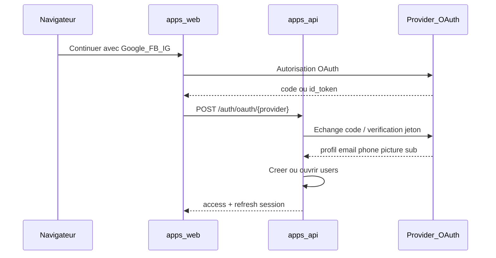

# Configuration OAuth — Google, Facebook, Instagram

|                   |                                                                                                                                                                     |
| ----------------- | ------------------------------------------------------------------------------------------------------------------------------------------------------------------- |
| Document          | Guide opérationnel pour obtenir les clés et brancher les providers                                                                                                  |
| Référence produit | [CDC.md](../CDC.md) §5.1, [PLAN_IMPLEMENTATION_BOULOTFLASH.md](../PLAN_IMPLEMENTATION_BOULOTFLASH.md)                                                                     |
| Étapes code       | [etape-08](etapes/etape-08-sessions-jwt-ecran-oauth.md), [etape-09](etapes/etape-09-oauth-providers-liaison-profil.md) — index [etapes/README.md](etapes/README.md) |
| Secrets           | Jamais dans le dépôt. Uniquement dans le fichier d’environnement Compose                                                                                            |

Ce document décrit **comment configurer les consoles** et **quelles variables** BoulotFlash attend. Il ne remplace pas le CDC.

## 1. Décisions de travail (non validées terrain)

| ID  | Décision                                                                                          | Conséquence                                                                        |
| --- | ------------------------------------------------------------------------------------------------- | ---------------------------------------------------------------------------------- |
| D29 | Plus d’OTP public. Connexion uniquement par Google, Facebook ou Instagram.                        | Pas de prestataire SMS pour l’auth publique.                                       |
| D30 | E-mail, téléphone et photo : d’abord le provider ; sinon saisie profil.                           | On n’invente rien. L’utilisateur complète après connexion.                         |
| D31 | Sans numéro (`+243…` pilote), consultation OK ; candidature / publication → `PHONE_REQUIRED`.     | Le numéro révélé est `users.phone` (provider ou profil).                           |
| D32 | Instagram via **app Meta**.                                                                       | `META_APP_ID` / `META_APP_SECRET` partagés, URI et scopes distincts.               |
| D33 | Premier login : créer. Ensuite : ouvrir si `provider`+`provider_user_id` ou e-mail vérifié connu. | Pas de second compte pour le même e-mail vérifié.                                  |
| D34 | OAuth **toujours réel**.                                                                          | Aucun `OAUTH_ADAPTER=simulated`, aucun jeton `demo:`, ni en test ni en production. |
| D35 | Comptes internes créés par l’admin BoulotFlash (super).                                              | Pas d’auto-inscription admin, pas d’OAuth admin.                                   |

Les providers ne garantissent pas toujours un téléphone. BoulotFlash demande les scopes disponibles ; si le numéro (ou le nom, ou la photo) manque, l’écran profil permet de le renseigner après connexion.

## 2. Architecture cible



Flux retenu : **Authorization Code** (avec PKCE côté web) pour Facebook et Instagram ; **Google Identity Services** (ID token ou code) vérifié côté serveur. L’API ne fait jamais confiance au profil tel que le navigateur le revendique sans vérification serveur.

### Variables d’environnement (noms)

```
# Google — obligatoires dès le premier démarrage de l’API (dev, test, prod)
GOOGLE_CLIENT_ID=
GOOGLE_CLIENT_SECRET=
GOOGLE_REDIRECT_URI=https://<domaine>/auth/callback/google

# Meta (Facebook + Instagram) — obligatoires idem
META_APP_ID=
META_APP_SECRET=
FACEBOOK_REDIRECT_URI=https://<domaine>/auth/callback/facebook
INSTAGRAM_REDIRECT_URI=https://<domaine>/auth/callback/instagram

# Politique
GOOGLE_EMAIL_POLICY=verified_google
```

**Interdiction du simulé.** Il n’existe pas de `OAUTH_ADAPTER=simulated`. Au démarrage, dans **tous** les `APP_ENV` (`development`, `test`, `production`), l’API refuse de démarrer si une des quatre clés `GOOGLE_*` / `META_*` est absente ou égale à un placeholder, ou si un flag de contournement OAuth est détecté. Les recettes d’auth utilisent les consoles Google / Meta en mode développement (utilisateurs testeurs), pas des jetons inventés.

### Données après connexion réussie

| Champ                | Source                                                                       |
| -------------------- | ---------------------------------------------------------------------------- |
| `email`              | Provider si vérifié ; sinon saisie profil (si le provider n’en a pas fourni) |
| `phone`              | Provider si E.164 ; sinon saisie profil (`+243` pilote)                      |
| `phone_confirmed_at` | Renseigné quand `phone` devient non null (provider ou enregistrement profil) |
| `avatar_url`         | Provider ; sinon upload profil (étape média) ou vide                         |
| `display_name`       | Provider si profil vide ; sinon saisie profil                                |
| `auth_identities`    | Une ligne par `(provider, provider_user_id)`                                 |

### Complétion du profil après connexion

1. OAuth réussit → session ouverte, compte créé ou rouvert.
2. Si nom, téléphone ou (selon règles métier) e-mail manquent → redirection vers « Compléter mon profil ».
3. L’utilisateur enregistre les champs manquants via `PATCH /me` (nom, téléphone, photo) puis complète candidat / recruteur via les routes profil.
4. Tant que `phone` est null → consultation des offres OK ; postuler / publier → `PHONE_REQUIRED`.

### Comptes internes

Créés uniquement par un **super-admin** déjà existant (bootstrap du premier super hors OAuth, documenté à l’étape 10 : script one-shot ou seed `SEED_DEMO` uniquement pour le premier super, puis création des autres via `POST /admin/users`). Jamais via Google / Facebook / Instagram.

## 3. Google — configuration console

### 3.1 Prérequis

- Compte Google Cloud
- Domaine de production (ou `localhost` pour le développement)
- Écran de consentement OAuth en mode **Testing** puis **Production**

### 3.2 Étapes détaillées

1. Ouvrir [Google Cloud Console](https://console.cloud.google.com/).
2. Créer un projet (ex. `boulotflash-pilote`).
3. **APIs et services → Écran de consentement OAuth** (ou **Google Auth Platform → Branding**)
   - Type : **Externe** (utilisateurs grand public).
   - Nom de l’application : BoulotFlash.
   - E-mail d’assistance et de contact développeur.
   - Domaines autorisés : le domaine de la PWA (sans chemin, sans `https://`).
   - **URLs branding** — remplir avec le tableau §3.2.1 ci-dessous (chemins canoniques BoulotFlash).
   - Scopes : `openid`, `email`, `profile`. Ne pas compter sur un scope téléphone Google grand public.
4. **APIs et services → Identifiants → Créer des identifiants → ID client OAuth**
   - Type : **Application Web**.
   - Origines JavaScript autorisées :
     - `http://localhost`
     - `https://<domaine-production>`
   - URI de redirection autorisés :
     - `http://localhost/auth/callback/google`
     - `https://<domaine-production>/auth/callback/google`
5. Copier **ID client** → `GOOGLE_CLIENT_ID`.
6. Copier **Secret client** → `GOOGLE_CLIENT_SECRET` (uniquement serveur).
7. Ajouter des utilisateurs de test tant que le consentement est en Testing.
8. Pour la publication : vérifier l’app (Google peut demander une vidéo et une politique de confidentialité).

### 3.2.1 URLs branding (accueil, confidentialité, conditions)

Google exige des liens **publics HTTPS** (souvent le même domaine que « Domaines autorisés »). `http://localhost` **ne convient pas** pour ces trois champs.

Chemins **canoniques** de l’app BoulotFlash (français simple, alignés sur l’aide in-app / D24) :

| Champ console Google | URL à saisir | Source du contenu |
| --- | --- | --- |
| Page d’accueil de l’application | `https://<domaine-production>/` | Accueil / liste des missions |
| Lien vers les règles de confidentialité | `https://<domaine-production>/confidentialite` | [POLITIQUE_CONFIDENTIALITE.md](POLITIQUE_CONFIDENTIALITE.md) |
| Lien vers les conditions d’utilisation | `https://<domaine-production>/conditions` | [CONDITIONS_UTILISATION.md](CONDITIONS_UTILISATION.md) |

**Domaine autorisé** (champ séparé, sans schéma ni chemin) : `<domaine-production>`  
Domaine enregistré : **boulotflash.com**. Exemple si le pilote est servi sur `app.boulotflash.com` (ou `boulotflash.com`) :

| Champ | Valeur proposée |
| --- | --- |
| Domaine autorisé | `app.boulotflash.com` |
| Page d’accueil | `https://app.boulotflash.com/` |
| Confidentialité | `https://app.boulotflash.com/confidentialite` |
| Conditions | `https://app.boulotflash.com/conditions` |

Remplacez `app.boulotflash.com` par le domaine réel du Compose / Caddy dès qu’il est connu (`boulotflash.com` ou sous-domaine). Tant que le domaine n’est pas branché :

1. Héberger des pages HTML **statiques** publiques (même texte que les MD, bandeau **projet, non validé**) sur un hôte HTTPS temporaire (Pages, bucket S3+CDN, etc.).
2. Mettre **ce** domaine temporaire dans « Domaines autorisés » **et** dans les trois URL.
3. Quand le domaine pilote est prêt : mettre à jour les trois URL + le domaine autorisé (et les origines / redirect URI du client OAuth).

Pages statiques de secours dans le dépôt (à publier sur l’hôte HTTPS choisi) : [legal-public/](legal-public/).

Sur les écrans publics, garder le bandeau **« Texte projet, non validé juridiquement »** jusqu’à validation locale (D24).

### 3.3 Ce que l’API BoulotFlash récupère

| Champ Google               | Usage BoulotFlash                                                       |
| -------------------------- | -------------------------------------------------------------------- |
| `sub`                      | `auth_identities.provider_user_id` (`google`)                        |
| `email` + `email_verified` | `users.email` si vérifié ; sinon refus (D10 / `GOOGLE_EMAIL_POLICY`) |
| `name`                     | `display_name` si vide                                               |
| `picture`                  | `avatar_url`                                                         |
| téléphone                  | En général **absent** → saisie profil après connexion                |

### 3.4 Vérification côté serveur

Vérifier la signature du `id_token` (aud = `GOOGLE_CLIENT_ID`) **ou** échanger le `code` contre des tokens puis appeler le userinfo Google. Toujours un appel réel à Google. Aucun jeton inventé.

## 4. Facebook — configuration Meta for Developers

### 4.1 Prérequis

- Compte Meta for Developers
- App de type **Consumer** ou **Business** selon la revue Meta
- URL de politique de confidentialité et conditions (même si marquées « projet, non validé » en local — D24)

### 4.2 Étapes détaillées

1. Ouvrir [Meta for Developers](https://developers.facebook.com/).
2. **Mes applications → Créer une application**.
3. Cas d’usage : **Authentifier et demander des données à des utilisateurs avec Facebook Login**.
4. Dans le tableau de bord de l’app :
   - Noter **Identifiant de l’application** → `META_APP_ID`
   - Noter **Clé secrète** → `META_APP_SECRET`
5. Ajouter le produit **Facebook Login** → **Web**.
6. **Facebook Login → Paramètres**
   - URI de redirection OAuth valides :
     - `http://localhost/auth/callback/facebook`
     - `https://<domaine-production>/auth/callback/facebook`
   - Mode développement : seuls les rôles (admin, développeur, testeur) se connectent.
7. **Paramètres → De base**
   - Domaines de l’application : `localhost` puis le domaine prod.
   - URL de la politique de confidentialité : **même** que Google → `https://<domaine-production>/confidentialite`
   - URL des conditions d’utilisation (si demandée) : `https://<domaine-production>/conditions`
   - URL du site / page d’accueil : `https://<domaine-production>/`
   - Catégorie adaptée (emploi / services locaux).
8. **Permissions et fonctionnalités** (revue App Review pour la prod) :
   - `public_profile` (standard)
   - `email` (standard)
   - `user_mobile_phone` ou équivalent : **avancé**, souvent refusé. Ne pas bloquer le MVP : l’utilisateur renseigne le téléphone sur son profil (D30, D31).

### 4.3 Flux technique

1. Le web redirige vers `https://www.facebook.com/v21.0/dialog/oauth` avec `client_id`, `redirect_uri`, `state`, `scope=public_profile,email`, PKCE si applicable.
2. Meta renvoie `?code=…`.
3. L’API échange le code : `GET graph.facebook.com/v21.0/oauth/access_token`.
4. L’API lit le profil : `GET /me?fields=id,name,email,picture.type(large)`.
5. Si une permission téléphone est accordée et qu’un numéro est présent, le normaliser en E.164 ; n’accepter `+243` pour le pilote Kinshasa (autres préfixes : hors pilote ou refus explicite).

### 4.4 Mapping

| Champ Facebook     | Usage BoulotFlash                                  |
| ------------------ | ----------------------------------------------- |
| `id`               | `auth_identities.provider_user_id` (`facebook`) |
| `email`            | `users.email`                                   |
| `name`             | `display_name`                                  |
| `picture.data.url` | `avatar_url`                                    |
| téléphone          | Si permission + valeur ; sinon saisie profil    |

## 5. Instagram — configuration Meta (même app)

### 5.1 Réalité produit

Il n’existe pas de « Login Instagram » grand public indépendant au même titre que Google. BoulotFlash utilise une **app Meta** et le produit **Instagram** documenté par Meta (Instagram API with Instagram Login / Facebook Login selon la version de la console).

Le bouton UI s’appelle **Continuer avec Instagram**. Sous le capot : OAuth Meta avec le produit Instagram de l’app.

### 5.2 Étapes détaillées

1. Réutiliser l’app Meta créée pour Facebook (même `META_APP_ID` / `META_APP_SECRET`), **ou** créer une app dédiée si Meta l’exige pour la revue Instagram.
2. Dans le tableau de bord : **Ajouter un produit → Instagram**.
3. Suivre l’assistant « API Instagram » / « Instagram Login » :
   - Créer ou lier un compte Instagram professionnel / Business de test.
   - Ajouter des comptes Instagram de test (rôles développeur).
4. **Instagram → Paramètres API**
   - URI de redirection OAuth :
     - `http://localhost/auth/callback/instagram`
     - `https://<domaine-production>/auth/callback/instagram`
5. Permissions typiques demandées (noms exacts selon la version Meta) :
   - Identité de base / `instagram_business_basic` ou équivalent Login
   - E-mail si exposé par le flux Login
   - **Pas de téléphone** garanti
6. Mode développement : seuls les comptes testeurs. Passage en Live + App Review avant le pilote public.
7. Documenter dans le registre la date de revue Meta et les permissions accordées.

### 5.3 Flux technique (Authorization Code)

1. Redirection vers l’endpoint Instagram / Meta Login indiqué par la console (URL et `client_id` = App ID).
2. Retour `code` sur `INSTAGRAM_REDIRECT_URI`.
3. Échange code → access token (endpoint token Meta / Instagram).
4. Lecture du profil : identifiant Instagram stable, username, éventuel e-mail, URL de photo de profil.
5. Persistance : `provider = instagram`, `provider_user_id = id Instagram`.

### 5.4 Mapping

| Champ Instagram / Meta            | Usage BoulotFlash                                                                        |
| --------------------------------- | ------------------------------------------------------------------------------------- |
| Identifiant utilisateur Instagram | `auth_identities.provider_user_id` (`instagram`)                                      |
| Username / nom                    | `display_name` si vide                                                                |
| E-mail si fourni et vérifié       | `users.email`                                                                         |
| Photo de profil                   | `avatar_url`                                                                          |
| Téléphone                         | En pratique **absent** → saisie profil ; sinon `PHONE_REQUIRED` pour postuler/publier |

### 5.5 Limite à afficher dans l’aide

Texte proposé (projet, non validé) : « Continuer avec Instagram ouvre votre compte Instagram via Meta. Le numéro n’est en général pas fourni : renseignez-le ensuite dans votre profil pour postuler ou publier. »

## 6. Règles métier de résolution de compte

Ordre serveur à chaque `POST /auth/oauth/{provider}` réussi :

1. Vérifier le jeton / code **auprès du provider réel** (Google ou Meta). Refuser tout jeton non vérifiable.
2. Refuser si e-mail présent mais non vérifié (Google) ou si la politique refuse.
3. Chercher `auth_identities` où `provider` + `provider_user_id` :
   - trouvé → ouvrir ce `users.id`, mettre à jour e-mail / phone / avatar si le provider les envoie et que le champ local est vide ou à rafraîchir selon la règle métier.
4. Sinon, si e-mail vérifié existe déjà sur un `users` :
   - rattacher une nouvelle ligne `auth_identities` à ce user (liaison).
5. Sinon → **créer** `users`, écrire `auth_identities`, session.
6. Si nom / téléphone / photo manquent → le client enchaîne sur « Compléter mon profil ».
7. Un compte `ADMIN` ne peut jamais être ouvert ni lié par ces routes. Les comptes internes sont créés par le super-admin (D35).
8. Deux comptes déjà distincts ne sont jamais fusionnés automatiquement (D09).

## 7. Checklist avant pilote

- [ ] `GOOGLE_CLIENT_ID` / `SECRET` et URI de redirect exacts (dev et prod)
- [ ] `META_APP_ID` / `SECRET`, Facebook Login + Instagram configurés
- [ ] Consentement Google : testeurs en Testing, puis Production
- [ ] App Meta : rôles testeurs en dev, Live + App Review pour le pilote
- [ ] Revue Instagram documentée
- [ ] Aucune variable d’adaptateur OAuth simulé dans aucun `.env`
- [ ] L’API refuse de démarrer sans les quatre secrets OAuth
- [ ] Parcours « Compléter mon profil » testé sans téléphone provider
- [ ] Compte interne créé uniquement via admin (pas OAuth)
- [ ] URLs branding Google / Meta : `/`, `/confidentialite`, `/conditions` (HTTPS public, D24)
- [ ] Domaine autorisé = domaine de ces trois URL (pas `localhost`)

## 8. Recettes avec providers réels

Les tests d’intégration auth utilisent :

- des **comptes testeurs** ajoutés dans Google Cloud (écran de consentement Testing) et Meta (rôles développeur / testeur) ;
- les URI `http://localhost/...` enregistrées dans les consoles ;
- le flux Authorization Code / ID token **réel**.

Pas de fichier de jetons `demo:` dans le dépôt. Les jeux de données seed peuvent préremplir des `auth_identities` pour des scénarios métier **après** qu’un vrai login a lié le compte, ou documenter les e-mails des testeurs Google/Meta utilisés en recette.

## 9. Liens officiels (à rouvrir le jour de la config)

- Google Cloud Console — Identifiants OAuth : `https://console.cloud.google.com/apis/credentials`
- Meta for Developers : `https://developers.facebook.com/apps/`
- Documentation Facebook Login : `https://developers.facebook.com/docs/facebook-login/`
- Documentation Instagram API / Login : `https://developers.facebook.com/docs/instagram-platform/`

Les chemins exacts de la console Meta évoluent. Si un menu a changé de nom, suivre l’assistant « Authentifier les utilisateurs » de l’app et reporter ici la date de la capture d’écran interne.
