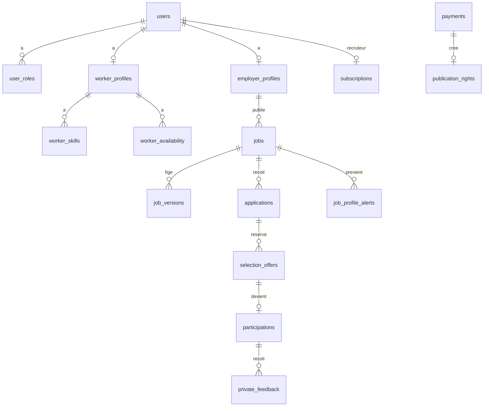

# Modèle de données complété

Référence : CDC section 14. Les noms de colonnes sont en anglais. Les statuts stockés sont les codes anglais. Les mots français de la section 9 du CDC sont des libellés d’interface, dans `packages/contracts/src/labels.fr.ts`.

Identifiants UUID. Dates `timestamptz`. Montants en entiers de la plus petite unité affichée : centimes de dollar pour USD, franc congolais entier pour CDF. Pas de flottant.

## Correspondance des statuts

| Français affiché | Code stocké | Entité |
| --- | --- | --- |
| Actif | `ACTIVE` | users |
| Incomplet | `INCOMPLETE` | users |
| Suspendu | `SUSPENDED` | users, jobs |
| Fermé | `CLOSED` | users |
| Brouillon | `DRAFT` | jobs |
| En modération | `IN_REVIEW` | jobs |
| Publiée | `PUBLISHED` | jobs |
| Pourvue | `FILLED` | jobs |
| Terminée | `COMPLETED` | jobs, participations |
| Expirée | `EXPIRED` | jobs, applications, selection_offers |
| Annulée | `CANCELLED` | jobs, participations, selection_offers |
| Rejetée | `REJECTED` | jobs, applications |
| Soumise | `SUBMITTED` | applications |
| Présélectionnée | `SHORTLISTED` | applications |
| Sélection proposée | `OFFERED` | applications |
| Acceptée | `ACCEPTED` | applications, selection_offers |
| Déclinée | `DECLINED` | applications, selection_offers |
| Retirée | `WITHDRAWN` | applications |
| Refusée | `REJECTED` | applications |
| Confirmée | `CONFIRMED` | participations |
| Absence | `NO_SHOW` | participations |
| En attente | `PENDING` | payments, selection_offers |
| En vérification | `UNDER_REVIEW` | payments |
| Confirmé | `CONFIRMED` | payments |
| Remboursé | `REFUNDED` | payments |

`DÉSACCORD` n’est pas un statut. C’est `participations.dispute_flag`.

## Relations



`applications.worker_id` pointe vers `users.id` du candidat. `jobs.employer_id` pointe vers `users.id` du recruteur. Un même `users.id` peut avoir les deux profils.

## Tables du CDC, colonnes ajoutées

Les colonnes déjà listées dans le CDC sont conservées. Ajouts :

### users

- `phone_confirmed_at timestamptz null` — rempli quand `phone` est non null (provider OAuth ou saisie profil validée)
- `age_confirmed_at timestamptz null`
- `display_name varchar(80) null` jusqu’au profil ; le profil candidat a le sien
- `avatar_url text null` — URL photo du provider (copie S3 possible plus tard)
- Contrainte : un compte public a au moins une ligne `auth_identities`. Un compte `ADMIN` a `password_hash` et aucune identité OAuth publique.

### auth_identities

- `id`, `user_id`, `provider` (`google` | `facebook` | `instagram`), `provider_user_id`, `created_at`
- Unique `(provider, provider_user_id)`
- Remplace l’ancien `users.google_sub` seul

### subscriptions

- `employer_id` unique : un abonnement courant par recruteur
- `ends_at` null au départ
- `suspended_reason text null`
- Pas de prix sur cette table

### platform_settings

Une seule ligne `id = 1`.

- `services_payants boolean not null default false`
- `dispute_window_hours integer not null default 48`
- `reminder_hours_before integer not null default 3`
- `proposal_min_hours integer not null default 2`
- `applications_per_rolling_day integer not null default 5`
- `updated_by uuid null`
- `updated_at timestamptz`

Les valeurs 48, 3 et 2 sont des hypothèses. Le seed les écrit et l’écran admin les montre comme « hypothèse de travail ».

### commercial_prices

- `id`, `type` `POST` ou `FEATURED`
- `amount integer`, `currency` `USD` ou `CDF`
- `duration_hours integer null` (mise en avant)
- `refund_terms text`
- `active boolean`
- Aucune ligne active tant que le super-admin n’a pas saisi un tarif

### payment_reviews

- `payment_id`, `reviewer_id`, `decision`, `reference_seen`, `amount_seen`, `received boolean`, `note`, `created_at`
- Une capture peut exister dans `payments.evidence_key` sans que `received` soit vrai

### jobs

- `mission_phone text null` (privé)
- `at_private_home boolean not null default false` pour le sensible « oui si domicile »
- `approved_once boolean` n’est pas sur l’offre : il se déduit de l’historique des validations
- `share_slug` non utilisé : l’URL est `/missions/{id}` et reste stable

### job_versions.snapshot

JSON figé : titre, description, catégorie, commune, repère public, coordonnées publiques, adresse privée, coordonnées privées, début, durée, montant, devise, base, mode et moment de paiement, prises en charge, nombre de personnes. L’adresse privée est dans l’instantané pour l’historique d’un litige, mais l’API ne la sert qu’aux parties d’une participation `CONFIRMED` de cette version.

### applications

Contrainte **unique `(job_id, worker_id)`** pour toute l’histoire (recommandation D02, alignée sur la recette 5 et la section 14). Pas d’index partiel « statut actif ».

### selection_offers

- `reserved_slot boolean not null` vrai seulement quand `status = PENDING` et `expires_at > now()`
- Un index partiel unique n’est pas le bon outil pour la capacité variable. La capacité est vérifiée par verrou, pas par un index.

### participations

- `worker_outcome` et `employer_outcome` : `COMPLETED`, `NO_SHOW`, `CANCELLED`, null
- `worker_declared_at`, `employer_declared_at`
- `dispute_flag boolean`
- `contact_revoked_at timestamptz null`

### notifications

- `channel` `IN_APP`, `EMAIL` (valeur `FCM` réservée hors pilote, non écrite au MVP)
- `dedupe_key text null`
- Unicité `(user_id, dedupe_key)` quand `dedupe_key` n’est pas null

L’alerte de correspondance n’écrit qu’une ligne `IN_APP`, `dedupe_key = job_match:{jobId}`.

### job_profile_alerts

- `job_id`, `user_id`, `created_at`
- unique `(job_id, user_id)`
- Empêche un second passage en `PUBLISHED` de réécrire l’alerte. Une republication est une autre offre, donc une autre ligne.

## Tables absentes du schéma CDC et nécessaires

### refresh_tokens

`id`, `user_id`, `token_hash`, `expires_at`, `revoked_at`, `replaced_by`, `user_agent`, `created_at`.

### otp_challenges

`id`, `phone`, `code_hash`, `expires_at`, `attempts`, `locked_until`, `consumed_at`, `purpose` `LOGIN` ou `PHONE_CHANGE` ou `MISSION_PHONE`.

Le code en clair n’est pas stocké. Le dernier envoi par numéro est dans Redis pour le délai de 60 secondes, et aussi en base pour survivre à un redémarrage : `last_sent_at`.

### otp_send_logs

`id`, `phone_masked`, `provider`, `cost_estimate_cdf`, `created_at`, `purpose`. Sert à BF-AUTH-09. Pas de numéro complet.

### admin_totp_secrets

`user_id` unique, `secret_encrypted`, `confirmed_at`.

### recovery_codes

`user_id`, `code_hash`, `used_at`.

### terms_documents

`id`, `kind` `TERMS` ou `PRIVACY`, `version`, `body_md`, `published_at`.

### terms_acceptances

`user_id`, `terms_document_id`, `accepted_at`. Unique `(user_id, terms_document_id)`.

### worker_availability

`worker_profile_id`, `weekday` 1–7, `slot` `MORNING` `AFTERNOON` `EVENING`. Unique des trois.

Créneaux de début, heure de Kinshasa : matin avant 12:00, après-midi de 12:00 à avant 18:00, soir à partir de 18:00.

### device_tokens

**Hors pilote (D36).** Table optionnelle réservée à une éventuelle réintroduction du push. Ne pas peupler ni exposer d’API au MVP.

### closed_identifiers

`kind` `PHONE` `EMAIL` `GOOGLE_SUB`, `value_hash`, `closed_at`, `reusable_at`. Pas la valeur en clair.

### phone_changes

`user_id`, `old_phone`, `new_phone`, `status` `PENDING_OLD` `PENDING_NEW` `PENDING_SUPPORT` `DONE` `REJECTED`, `reviewed_by`.

### contact_access_logs

`actor_id`, `participation_id`, `created_at`. Toute lecture admin des coordonnées. Les parties elles-mêmes ne remplissent pas ce journal à chaque affichage : leur droit est la participation. L’ouverture admin, oui (CDC : accès administratif journalisé).

### idempotency_keys

`user_id`, `key`, `request_hash`, `response_code`, `response_body`, `created_at`. Unique `(user_id, key)`.

### data_export_requests

`user_id`, `status`, `file_key`, `expires_at`, `created_at`.

### report_appeals

`report_id` ou `user_id` suspendu, `body`, `status` `OPEN` `CLOSED`, `handler_id`, une seule ligne par suspension (`appeal_used boolean` sur le dossier).

### audit_logs

Déjà au CDC. `metadata` jsonb sans téléphone complet ni adresse exacte. Les actions : `ADMIN_LOGIN`, `SUSPEND`, `EXPORT`, `PRICE_CHANGE`, `PAYMENT_CONFIRM`, `OPEN_DOCUMENT`, `SERVICES_PAYANTS_ON`, `SERVICES_PAYANTS_OFF`, `OPEN_CONTACT`.

## Index

- `jobs (commune_id, category_id, published_at desc)` où `status = PUBLISHED`
- `jobs (employer_id, created_at desc)`
- `applications (worker_id, applied_at desc)`
- `applications (job_id)`
- `selection_offers (status, expires_at)` où `status = PENDING`
- `participations (worker_id)`, `participations (employer_id)`
- `notifications (user_id, created_at desc)` où `channel = IN_APP` et `read_at is null`
- `payments (status)` où `status in (PENDING, UNDER_REVIEW)`
- `publication_rights (employer_id, status)` où `status = AVAILABLE`
- unique partiel `users(phone)`, `users(email)` où la colonne n’est pas null
- unique `auth_identities(provider, provider_user_id)`
- unique `publication_rights(payment_id)` où `payment_id` n’est pas null
- unique `job_profile_alerts(job_id, user_id)`
- unique `applications(job_id, worker_id)`
- unique `subscriptions(employer_id)`

## Champs privés

Ne jamais les mettre dans un DTO public, un cache Redis de liste, un journal, une notification, une métadonnée de partage ou un service worker.

- `users.phone`, sauf masqué `+2438****1234` dans les logs
- `jobs.address_private`, `private_latitude`, `private_longitude`, `mission_phone`
- `employer_profiles.address_private`, `mission_phone`
- `job_versions.snapshot` : filtrer avant envoi
- clés S3 des justificatifs
- secrets TOTP, empreintes, jetons

## Suppression et conservation

| Donnée | Règle |
| --- | --- |
| Compte fermé sur demande | Anonymiser le nom, retirer phone et email de `users`, supprimer les `auth_identities`, écrire les empreintes (phone, email, provider_user_id) dans `closed_identifiers` pour 90 jours, supprimer la photo S3, garder les participations avec un auteur « compte fermé » pendant 24 mois |
| Fraude | Fermeture admin, même blocage 90 jours, historique d’audit conservé |
| Justificatif de structure | Supprimer l’objet S3 12 mois après la décision, ou plus tôt si le recruteur retire la demande |
| Export CSV | Supprimer l’objet 7 jours après création |
| URL pré-signée | 15 minutes pour le média, 5 minutes pour le privé. Pas de révocation technique : la durée courte est la mesure |
| Reçus de paiement | Conservés selon la durée comptable. Ne pas les anonymiser avec le compte avant cette durée. Le plan ne fixe pas le délai légal : D24 |
| Missions | 24 mois après la dernière activité, puis anonymisation, sous réserve de la validation locale |
| Position du navigateur | Non stockée |
| OTP | Supprimer le défi consommé ou expiré sous 24 heures. Garder le journal de coût sans numéro complet |

## Migrations

L’ordre des migrations Prisma, une par étape qui touche le schéma :

1. Étape 05 : toutes les tables ci-dessus, vides de métier, plus les index et contraintes. Mieux vaut le schéma complet tôt que des migrations contradictoires. Les modules n’exposent pas encore les routes.
2. Les étapes suivantes n’ajoutent une migration que si la recette de l’étape 05 a montré un manque. Ne pas réécrire une migration déjà appliquée : en ajouter une.

SQL à relire en recette, dans la migration, pas seulement dans Prisma :

```sql
CREATE UNIQUE INDEX users_phone_uq ON users (phone) WHERE phone IS NOT NULL;
CREATE UNIQUE INDEX users_email_uq ON users (email) WHERE email IS NOT NULL;
CREATE UNIQUE INDEX auth_identities_provider_uq ON auth_identities (provider, provider_user_id);
CREATE UNIQUE INDEX applications_pair_uq ON applications (job_id, worker_id);
CREATE UNIQUE INDEX rights_payment_uq ON publication_rights (payment_id) WHERE payment_id IS NOT NULL;
CREATE UNIQUE INDEX alerts_pair_uq ON job_profile_alerts (job_id, user_id);
-- Compte public : au moins une auth_identities ; compte admin : password_hash
-- (contrainte applicative + éventuel trigger ; un admin n'a pas d'identité OAuth publique)
```

Le verrou de capacité n’est pas une contrainte SQL. Il est dans le service de sélection :

```text
BEGIN
SELECT workers_needed, status, apply_deadline, selection_deadline
  FROM jobs WHERE id = :id FOR UPDATE
-- compter PENDING non expirés + participations status <> CANCELLED
-- refuser si le nouveau occupant dépasse workers_needed
COMMIT
```

## Seed

`packages/database/prisma/seed.ts` appelle les jeux de [jeux-de-donnees.md](jeux-de-donnees.md). Il ne s’exécute que si `SEED_DEMO=true`. Cette variable est refusée en production.
